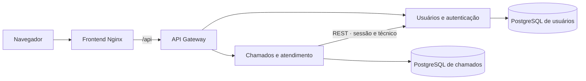

# HelpDesk

Sistema web de gerenciamento de chamados de suporte técnico. Projeto acadêmico de Ciência da Computação do CEUB.

**Demonstração para a aula:** [abrir HelpDesk](https://helpdesk-ceub.onrender.com/) · [abrir Swagger](https://helpdesk-ceub.onrender.com/api-docs/) · [ver skills](SKILLS.md).

A demonstração usa dados fictícios. O primeiro acesso após inatividade pode demorar enquanto os serviços Free retomam.

O navegador acessa o frontend Nginx e suas rotas REST na mesma origem. Um API Gateway encaminha as requisições a dois microsserviços Flask. Cada serviço usa seu próprio PostgreSQL 16.



## Executar no Windows

Com Docker Desktop em modo de contêineres Linux e Python 3.12, abra o PowerShell na pasta do projeto.

```powershell
python scripts/configure.py
docker compose up -d --build --wait
docker compose ps
```

Abra [http://localhost:8080](http://localhost:8080). Use `ADMIN_EMAIL` e `ADMIN_PASSWORD` do arquivo local `.env`. A conta é criada uma vez, no primeiro início do banco de usuários. Alterações posteriores no arquivo não redefinem o cadastro. Troque a senha pela tela **Usuários**.

Se a porta 8080 estiver ocupada, ajuste `PORT` no `.env`, ou gere o arquivo inicialmente com `python scripts/configure.py --port 8088`. Em caso de falha, veja `docker compose ps` e `docker compose logs --tail 80`.

`docker compose down` para e remove os contêineres mantendo os volumes. Para voltar após uma alteração, execute novamente `docker compose up -d --build --wait`.

## Documentação da API e skills

- [Swagger UI local](http://localhost:8080/api-docs/) com operações interativas. Faça login no HelpDesk ou execute a operação de login no próprio Swagger para usar a sessão do navegador.
- [Especificação OpenAPI](frontend/api-docs/openapi.json) com rotas, permissões e formatos de entrada e saída.
- [Skills e tecnologias aplicadas](SKILLS.md).
- [Configuração de hospedagem](render.yaml) para três serviços web Free e dois bancos PostgreSQL externos.

## Apresentação

1. Entre como administrador e cadastre uma conta de solicitante e outra de técnico em **Usuários**. Confira o catálogo em **Categorias**.
2. Entre como solicitante, clique em **Novo chamado**, preencha os dados e anexe um arquivo na tela do chamado. O prazo depende da prioridade escolhida.
3. Volte para a conta administrativa, abra o chamado na fila e atribua o técnico cadastrado.
4. Entre como técnico, abra o chamado atribuído e selecione **Em atendimento**. Registre um comentário e passe para **Aguardando usuário**.
5. Como solicitante, responda pelo histórico do chamado. Como técnico, selecione **Resolvido**, registre a solução e passe para **Fechado**.
6. Entre como administrador e abra **Relatórios**. Confira o volume por status, o tempo médio até a resolução e os chamados atribuídos por técnico.

## Notificações opcionais

Configure `SMTP_HOST`, `SMTP_PORT` e `SMTP_FROM` no `.env`. Para servidores autenticados, preencha também `SMTP_USERNAME` e `SMTP_PASSWORD`. STARTTLS fica ligado por padrão. Em um ambiente de teste isolado, um servidor SMTP local sem TLS pode exigir `SMTP_STARTTLS=0`.

```powershell
docker compose --profile email up -d --build --wait
docker compose logs --tail 40 mailer
```

O solicitante recebe e-mails na abertura e nas mudanças de status. O técnico recebe um e-mail ao ser atribuído. O envio ocorre em segundo plano com novas tentativas em caso de falha.

## Testes

Os testes de integração criam registros fictícios. Execute-os em uma instância exclusiva de teste com um `.env` gerado por este projeto.

```powershell
python -m pip install requests==2.32.5
python tests/integration.py flow --fixture .env.test-fixture.json
docker compose down
docker compose up -d --wait
python tests/integration.py persistence --fixture .env.test-fixture.json
```

Em outra porta, acrescente `--url http://127.0.0.1:8088` a cada comando de teste. Consulte a [arquitetura](docs/arquitetura.md) e o [registro de testes](docs/testes.md).
