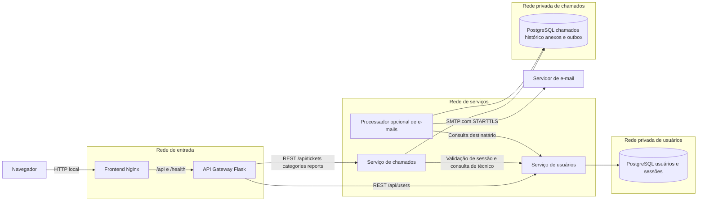
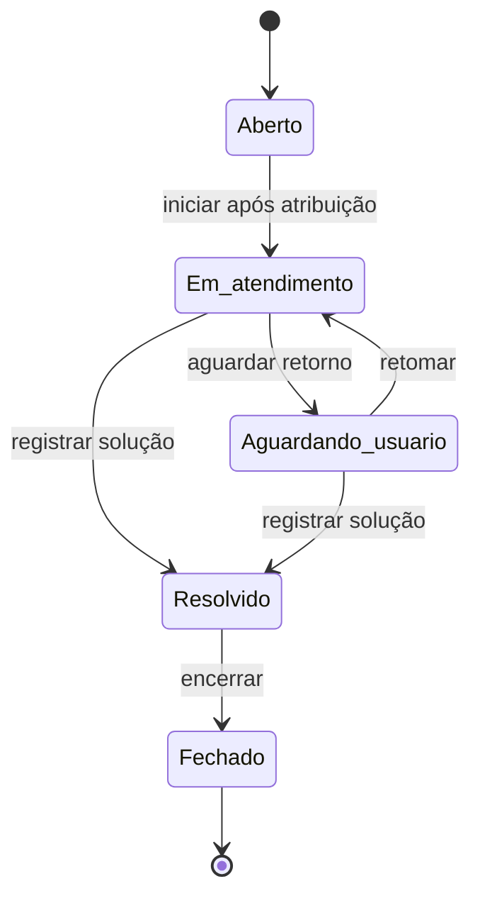

# Arquitetura do sistema web HelpDesk

**CEUB · Ciência da Computação**

**Versão 2.0 · 19 de novembro de 2026**

## 1. Visão geral

O HelpDesk centraliza solicitações de suporte técnico. O solicitante acompanha o chamado desde a abertura. O técnico registra o atendimento e a solução. A administração mantém o cadastro, organiza a fila e consulta os indicadores. Este documento descreve os componentes, os fluxos e as condições de operação da entrega.

O sistema cobre autenticação, perfis, categorias, atribuição, comentários, histórico, anexos, prazo, relatórios e notificações por e-mail quando configuradas. Integração com ITSM, aplicativo móvel nativo, inventário, base de conhecimento, chat e faturamento ficam fora deste escopo.

## 2. Funcionalidades e requisitos não funcionais

| Perfil | Escopo e operações |
| --- | --- |
| Solicitante | Abre chamados. Consulta, comenta e anexa arquivos aos próprios chamados. Acompanha prazo, status e histórico. |
| Técnico | Consulta, comenta e anexa arquivos aos chamados atribuídos. Atualiza o status e registra a resolução. |
| Administrador | Gerencia perfis, usuários e categorias. Consulta qualquer chamado, atribui técnicos, atualiza atendimentos e acessa relatórios. |

| Objetivo | Meta e estado |
| --- | --- |
| Disponibilidade | Meta de 99,9%. O ambiente acadêmico tem uma instância por componente e não mede disponibilidade em produção. |
| Desempenho | Meta de resposta média inferior a 300 ms sob carga a definir. Os testes funcionais não comprovam essa meta. |
| Escalabilidade | Serviços de aplicação passíveis de réplica sobre armazenamento compartilhado por serviço. Compose local usa uma instância de cada. |
| Segurança e privacidade | Medidas proporcionais ao ambiente local e alinhamento com práticas OWASP. Avaliação de LGPD e controles de operação ficam para uma implantação real. |
| Manutenibilidade | Contratos REST, responsabilidade clara por serviço, variáveis de ambiente, inicialização repetível e integração automatizada. |

## 3. Arquitetura geral

O sistema tem dois microsserviços de domínio. A separação isola credenciais e sessões dos dados de atendimento. O gateway oferece uma entrada uniforme, e os serviços conservam responsabilidade por seus dados e regras. Cada componente tem sua própria imagem e depende de contratos HTTP explícitos.

### Camadas e componentes

- **Apresentação.** HTML e CSS responsivos com JavaScript nativo, busca, filtros, formulários e painel por perfil. Nginx serve os arquivos e encaminha `/api/` com o caminho original.
- **Entrada.** API Gateway Flask roteia por recurso, repassa cabeçalhos necessários e define limites de espera e respostas JSON para falha no upstream.
- **Domínio.** Usuários valida a sessão, administra contas e controla perfis. Chamados administra a fila, o catálogo, a linha do tempo, os anexos, os prazos e os indicadores.
- **Dados.** SQLAlchemy ORM e Psycopg gerenciam dois bancos PostgreSQL 16. As referências de usuário no banco de chamados são IDs de domínio validados via REST.
- **Infraestrutura.** Docker Compose coordena imagens independentes, redes, volumes persistentes e verificações de saúde. Backends usam Gunicorn no contêiner.

## 4. Fluxos e integrações

1. O navegador envia `POST /api/users/login` pela mesma origem. Nginx encaminha ao gateway, e Usuários compara o hash da senha. Uma sessão nova é registrada no PostgreSQL, e o navegador recebe um cookie.
2. Para uma consulta ou alteração de chamado, o gateway envia a solicitação a Chamados. Chamados consulta `/api/users/me` no serviço de usuários e aplica o escopo do perfil ao consultar o próprio banco.
3. Ao atribuir, Chamados consulta o cadastro interno de Usuários para validar o técnico ativo. A alteração e o evento de histórico são gravados na mesma transação. O registro do histórico inclui ID, nome do autor, evento e horário.
4. Se configurado, Chamados grava uma notificação na outbox de seu banco dentro da transação de negócio. O processo de e-mail consulta o destinatário por REST e envia via SMTP. Falhas recebem novas tentativas com atraso crescente de até uma hora. O processamento é de pelo menos uma vez, portanto uma interrupção após aceite SMTP e antes da confirmação no banco pode duplicar a entrega.

Não há broker externo. O processador de e-mails é parte do domínio de chamados e pode ser executado como processo separado via perfil `email` do Compose. A integração SMTP pertence ao operador da instalação.

### Ciclo do chamado e prazo

O SLA é contado em horas corridas a partir da abertura. Aguardando usuário não pausa a contagem. O prazo é congelado na abertura e o resultado é avaliado na resolução. Prioridade baixa tem 72 horas, média 24, alta 8 e crítica 4. O tempo médio em relatórios mede da abertura à resolução. O relatório por técnico conta a atribuição atual, inclusive de chamados concluídos.

### Contrato REST

| Recurso | Métodos e operações |
| --- | --- |
| `/api/users/login`, `/api/users/logout`, `/api/users/me` | Iniciar e revogar sessão, consultar conta autenticada |
| `/api/users`, `/api/users/{id}` | Listar, cadastrar e editar contas |
| `/api/categories`, `/api/categories/{id}` | Listar, criar, renomear e arquivar categorias |
| `/api/tickets`, `/api/tickets/{id}` | Listar, abrir e consultar detalhes, anexos e histórico |
| `/api/tickets/{id}/assignment`, `/api/tickets/{id}/status` | Atribuir técnico e avançar no ciclo |
| `/api/tickets/{id}/comments`, `/api/tickets/{id}/attachments` | Adicionar comentário e enviar arquivo |
| `/api/tickets/{id}/attachments/{anexo}` | Baixar anexo dentro do escopo do chamado |
| `/api/reports` | Consultar volume, tempo de resolução e atribuições |
| `/health` | Checar a cadeia frontend, gateway, serviços e bancos |

## 5. Segurança

Senhas usam hash scrypt. A sessão é um token aleatório de oito horas, com apenas o digest SHA-256 persistido. O cookie é HttpOnly e SameSite Strict, e pode usar Secure numa instalação HTTPS. O logout, a mudança de perfil, a desativação e a troca de senha revogam as sessões correspondentes. A conta administrativa inicial permanece ativa como opção de recuperação local.

O frontend opera na mesma origem, sem CORS aberto. As operações de escrita exigem um cabeçalho personalizado, e o Nginx limita tentativas de login por IP. O backend valida os tipos e limites de entrada, aplica o escopo no banco e parametriza consultas por ORM. O frontend renderiza dados como texto e aplica Content Security Policy. Anexos são limitados a cinco por chamado, de até 5 MiB cada, com extensões permitidas e download forçado. Não há verificação antivírus.

O gateway é o único consumidor do proxy de entrada. As rotas internas de Usuários exigem uma chave de serviço, repassada apenas na rede privada. A única porta publicada se liga ao loopback. Senhas e chaves ficam no `.env` local. Produção requer TLS, gestão externa de segredos, política de retenção, criptografia em repouso, controle de backups e análise formal de privacidade.

## 6. Escalabilidade e desempenho

A sessão é persistida no banco de usuários. As instâncias HTTP podem compartilhar a mesma base do respectivo domínio. Índices apoiam consultas por solicitante, técnico, status e histórico. A criação de esquema precede os workers e usa um bloqueio transacional por banco. Atualizações do mesmo chamado usam bloqueio de linha para serializar transições e anexos.

Não há CDN, cache distribuído ou balanceamento entre réplicas nesta entrega. A listagem carrega todos os chamados permitidos ao perfil. Uma expansão de volume deve acrescentar paginação e acompanhar tempo de resposta, tamanho da outbox e custo de armazenar anexos no banco.

## 7. Disponibilidade e recuperação

- **Persistência.** Os volumes nomeados conservam dados entre recriações dos contêineres. Os anexos fazem parte do backup do banco de chamados.
- **Backup.** Para um ambiente persistente, agende um `pg_dump -Fc` separado para cada banco, armazene os arquivos fora do host e teste a restauração com `pg_restore`. Suspenda gravações enquanto exporta os dois bancos se a cópia precisa representar o mesmo ponto operacional.
- **Recuperação.** Recrie a infraestrutura, recupere as credenciais da instalação, restaure as duas bases e execute a verificação de saúde. Valide login, dados, anexos e atribuições. RTO e RPO precisam ser definidos e testados antes de uma operação real.
- **Saúde.** Compose consulta PostgreSQL com `pg_isready`. Cada backend verifica o próprio banco. O gateway agrega o estado dos dois serviços, e o frontend consulta o gateway pela rota `/health`. A instalação acadêmica usa logs e estado de saúde do Compose, sem serviço de alertas.

## 8. Ambientes

| Ambiente | Endereço ou execução | Finalidade |
| --- | --- | --- |
| Desenvolvimento e demonstração | `http://localhost:8080` | Docker Compose com variáveis e volumes locais |
| Integração | Ambiente efêmero de teste | Construção, teste de ponta a ponta e recriação com dados persistidos |
| Homologação e produção | Sem endereço provisionado | Exigiriam TLS, monitoramento, backup programado e política de acesso |

## 9. Decisões arquiteturais

- **ADR 001 — Domínios e bancos independentes.** Usuários e Chamados evoluem em processos separados. A autorização de chamados depende da disponibilidade da API de usuários e não acessa as tabelas de identificação.
- **ADR 002 — Sessão opaca e mesma origem.** Uma sessão persistida facilita revogação imediata e evita armazenamento do token em JavaScript. Cada acesso a chamados consulta a identidade ativa por REST.
- **ADR 003 — Criação de esquema fora dos workers.** A inicialização precede Gunicorn e usa bloqueio consultivo no PostgreSQL. Alterações incompatíveis futuras exigem migrações versionadas antes da atualização.
- **ADR 004 — Outbox na base de chamados.** A notificação é registrada na transação do chamado e enviada de forma assíncrona pelo processador. Esse desenho evita a dependência síncrona de SMTP.
- **ADR 005 — Inativação em vez de exclusão.** Usuários e categorias podem ser inativados para preservar referências e histórico existentes. Chamados abertos de um técnico inativo podem ser reatribuídos.

## 10. Glossário

| Termo | Significado |
| --- | --- |
| API REST | Contrato HTTP que expõe operações sobre recursos do sistema |
| Gateway | Ponto de entrada que encaminha a requisição ao serviço responsável |
| SLA | Prazo de resolução conforme a prioridade do chamado |
| Outbox | Tabela de notificações pendentes de envio assíncrono |
| SMTP | Protocolo para transmissão de mensagens de e-mail |
| RPO | Perda de dados máxima aceitável em uma recuperação |
| RTO | Tempo máximo aceitável para retomar a operação |
| LGPD | Lei Geral de Proteção de Dados Pessoais |
| OWASP | Organização que publica referências de segurança para aplicações |

## 11. Histórico de revisões

| Versão | Data | Revisão |
| --- | --- | --- |
| 1.0 | 28/10/2026 | Rascunho de requisitos e escopo do projeto |
| 2.0 | 19/11/2026 | Arquitetura implementada, fluxos, segurança, recuperação e operação local |

A sequência de demonstração está no [README](../README.md). Os resultados verificáveis estão no [registro de testes](testes.md).
